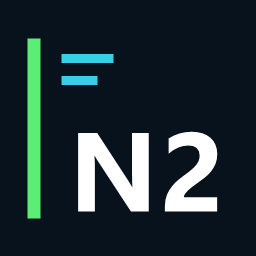

<p align="center">
  
</p>

<h1 align="center">NFSU2.xyz Discord Presence</h1>

<p align="center">
  An unofficial Discord Rich Presence companion for <a href="https://nfsu2.xyz/">Underground 2 Revived</a>.
</p>

<p align="center">
  <a href="README.md">English</a> ·
  <a href="leia-me.md">Português</a>
</p>

<p align="center">
  <a href="https://github.com/jackson070110/nfsu2.xyz-discord-presence/releases">Releases</a> ·
  <a href="https://nfsu2.xyz/">Website</a> ·
  <a href="https://github.com/jackson070110/nfsu2.xyz-discord-presence/issues">Report an Issue</a> ·
  <a href="https://discord.com/developers/applications">Discord Developer Portal</a>
</p>

> [!IMPORTANT]
> **Unofficial community project:** This project is independent and is not
> affiliated with, endorsed by, maintained, or supported by the operators of
> [NFSU2.xyz](https://nfsu2.xyz/), Electronic Arts, or Discord.

---

## What does it do?

When you play **Underground 2 Revived** on [NFSU2.xyz](https://nfsu2.xyz/), this
project shows your game activity on your Discord profile. The presence stays
active while a game tab is open, including in the background, and clears after
the last game tab is closed.

The browser extension detects the game tab. A small Windows companion sends
the activity to the Discord desktop app.

## Features

- Shows a Discord Rich Presence while NFSU2.xyz is open.
- Keeps the presence active when the game tab is in the background.
- Clears the presence when all game tabs are closed.
- Uses the same extension ID.
- Does not require a Discord bot, bot token, or Discord account password.

## Requirements

- Windows 10 or 11.
- Node.js 18 or later.
- Brave or Google Chrome.
- The Discord desktop app, open and signed in.
- A Discord application with its numeric Application ID.

## Configure Discord Rich Presence

1. Create an application in the [Discord Developer Portal](https://discord.com/developers/applications).
2. Copy the application's **Application ID**. Do not create a bot or share a
   token or client secret.
3. Under **Rich Presence → Art Assets**, upload a cover image and copy its
   asset key, for example `underground2_cover`. The cover shown on this
   repository is not automatically used as your Discord activity artwork.

## Manual installation

1. In Brave or Chrome, remove any old copy of this extension, if present.
2. Open the browser's extensions page, enable **Developer mode**, choose **Load
   unpacked**, and select this repository's `extension` folder.
3. Copy the extension ID shown by the browser. The same ID is used by Brave
   and Chrome.
4. Open PowerShell in the repository folder and run:

       .\companion\setup.ps1

5. Enter the extension ID, Discord Application ID, and uploaded cover asset
   key when prompted.
6. Restart the browser and Discord, then visit [NFSU2.xyz](https://nfsu2.xyz/).

## Troubleshooting

- Confirm that the extension is enabled on the browser's extensions page.
- If you update the extension files, click **Reload** on that page.
- Make sure the Discord desktop app is running and activity sharing is allowed
  in Discord's privacy settings.
- If the activity does not appear, inspect the extension service worker's
  **Console** on the extensions page.

## Uninstall

Remove the extension from Brave or Chrome. To remove the Windows companion,
delete these per-user registry keys, if present, and the folder
`%LOCALAPPDATA%\NFSU2Presence`:

```text
HKEY_CURRENT_USER\Software\BraveSoftware\Brave-Browser\NativeMessagingHosts\com.nfsu2.discord_presence
HKEY_CURRENT_USER\Software\Google\Chrome\NativeMessagingHosts\com.nfsu2.discord_presence
```

## Credits & disclaimer

- Thanks to [NFSU2.xyz](https://nfsu2.xyz/) for hosting Underground 2 Revived,
  the browser game this companion works with.
- Thanks to [th0mk/nfsu2-web](https://github.com/th0mk/nfsu2-web), the open-source
  web project related to Underground 2 Revived on NFSU2.xyz.

This Discord Presence project is an independent companion and is not
affiliated with, endorsed, or maintained by the NFSU2.xyz or nfsu2-web
maintainers, Electronic Arts, or Discord. *Need for Speed* and *Need for Speed:
Underground 2* are trademarks of Electronic Arts Inc. This repository does not
distribute game files or copyrighted game assets.

## Tests

Run the tests from the repository folder:

```powershell
node --test companion/test/*.test.js extension/*.test.js
```
