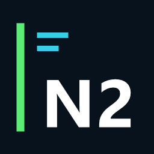

<p align="center">
  
</p>

<h1 align="center">Presença do Discord para NFSU2.xyz</h1>

<p align="center">
  Um complemento não oficial de Rich Presence para <a href="https://nfsu2.xyz/">Underground 2 Revived</a>.
</p>

<p align="center">
  <a href="README.md">English</a> ·
  <a href="leia-me.md">Português</a>
</p>

<p align="center">
  <a href="https://github.com/jackson070110/nfsu2.xyz-discord-presence/releases">Versões</a> ·
  <a href="https://nfsu2.xyz/">Site</a> ·
  <a href="https://github.com/jackson070110/nfsu2.xyz-discord-presence/issues">Relatar um problema</a> ·
  <a href="https://discord.com/developers/applications">Discord Developer Portal</a>
</p>

> [!IMPORTANT]
> **Projeto comunitário não oficial:** Este projeto é independente e não é
> afiliado, endossado, mantido ou apoiado pelos responsáveis pelo
> [NFSU2.xyz](https://nfsu2.xyz/), pela Electronic Arts ou pelo Discord.

---

## O que ele faz?

Ao jogar **Underground 2 Revived** no [NFSU2.xyz](https://nfsu2.xyz/), este
projeto mostra sua atividade no perfil do Discord. A presença continua
enquanto uma aba do jogo estiver aberta, mesmo em segundo plano, e é removida
quando a última aba do jogo for fechada.

A extensão do navegador detecta a aba do jogo. Um pequeno componente para
Windows envia a atividade ao aplicativo Discord para computador.

## Recursos

- Mostra Rich Presence no Discord enquanto o NFSU2.xyz está aberto.
- Mantém a presença ativa quando a aba do jogo está em segundo plano.
- Remove a presença quando todas as abas do jogo são fechadas.
- Usa o mesmo ID da extensão no Brave e no Google Chrome.
- Não precisa de bot, token de bot ou senha da conta do Discord.

## Requisitos

- Windows 10 ou 11.
- Node.js 18 ou superior.
- Brave ou Google Chrome.
- Aplicativo Discord para computador aberto e conectado.
- Um aplicativo Discord com seu Application ID numérico.

## Configure o Rich Presence no Discord

1. Crie um aplicativo no [Discord Developer Portal](https://discord.com/developers/applications).
2. Copie o **Application ID** do aplicativo. Não crie bot nem compartilhe
   token ou client secret.
3. Em **Rich Presence → Art Assets**, envie uma imagem de capa e copie a chave
   do asset, por exemplo `underground2_cover`. A capa deste repositório não é
   usada automaticamente como arte da sua atividade no Discord.

## Instalação manual

1. No Brave ou Chrome, remova uma cópia antiga desta extensão, se houver.
2. Abra a página de extensões do navegador, ative o **Modo do desenvolvedor**,
   escolha **Carregar sem compactação** e selecione a pasta `extension` deste
   repositório.
3. Copie o ID da extensão exibido pelo navegador. O mesmo ID é usado no Brave
   e no Chrome.
4. Abra o PowerShell na pasta do repositório e execute:

       .\companion\setup.ps1

5. Quando solicitado, informe o ID da extensão, o Application ID do Discord
   e a chave do asset da capa enviada.
6. Reinicie o navegador e o Discord e abra [NFSU2.xyz](https://nfsu2.xyz/).

## Solução de problemas

- Confirme se a extensão está ativada na página de extensões do navegador.
- Se atualizar os arquivos da extensão, clique em **Recarregar** nessa página.
- Confira se o Discord para computador está aberto e se o compartilhamento de
  atividade está permitido nas configurações de privacidade.
- Se a atividade não aparecer, consulte o **Console** do service worker da
  extensão na página de extensões.

## Desinstalação

Remova a extensão do Brave ou Chrome. Para remover o componente do Windows,
exclua as chaves por usuário abaixo, se existirem, e a pasta
`%LOCALAPPDATA%\NFSU2Presence`:

```text
HKEY_CURRENT_USER\Software\BraveSoftware\Brave-Browser\NativeMessagingHosts\com.nfsu2.discord_presence
HKEY_CURRENT_USER\Software\Google\Chrome\NativeMessagingHosts\com.nfsu2.discord_presence
```

## Créditos e aviso legal

- Obrigado ao [NFSU2.xyz](https://nfsu2.xyz/) por disponibilizar o Underground
  2 Revived, o jogo no navegador com o qual este complemento funciona.
- Obrigado ao projeto aberto [th0mk/nfsu2-web](https://github.com/th0mk/nfsu2-web),
  relacionado ao Underground 2 Revived no NFSU2.xyz.

Este projeto de Rich Presence é um complemento independente e não é afiliado,
endossado ou mantido pelos responsáveis pelo NFSU2.xyz ou pelo nfsu2-web, pela
Electronic Arts ou pelo Discord. *Need for Speed* e *Need for Speed:
Underground 2* são marcas registradas da Electronic Arts Inc. Este repositório
não distribui arquivos nem recursos protegidos do jogo.

## Testes

Execute os testes na pasta do repositório:

```powershell
node --test companion/test/*.test.js extension/*.test.js
```
